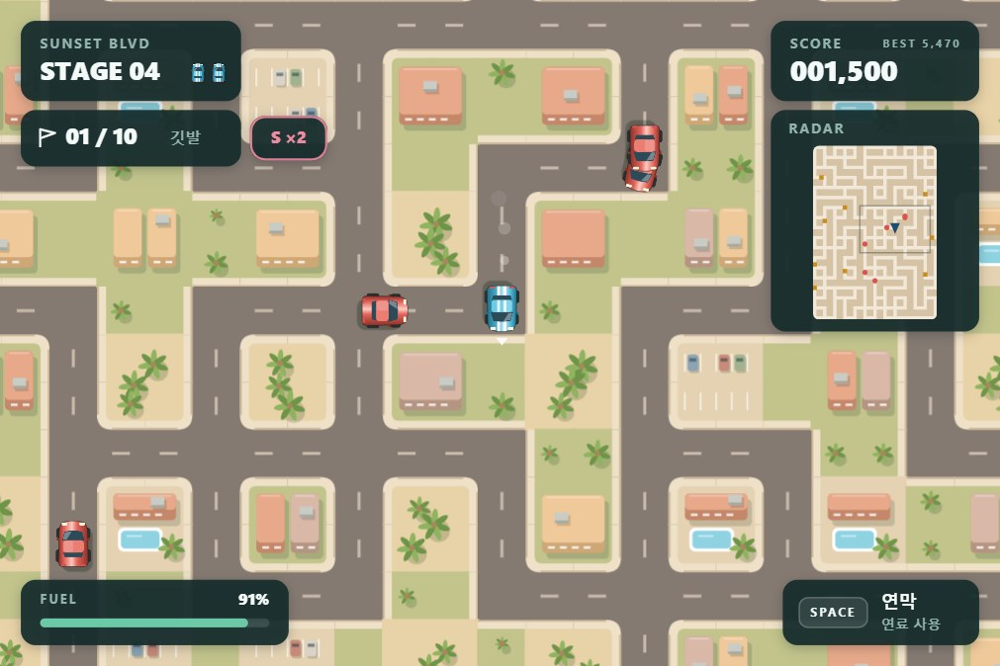
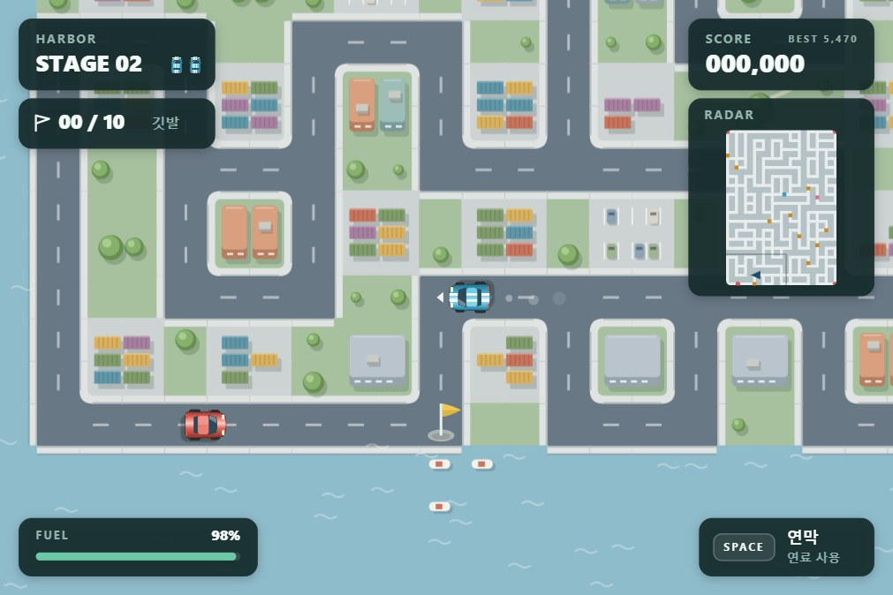

[지난번 연쇄 폭발](/p/ai-game-lab-build-12/)은 한 번 누르고 지켜보는 게임이었습니다. 이번에는 미로를 달리며 깃발을 줍고, 뒤에서 쫓아오는 빨간 차를 따돌립니다. AI 게임 랩의 열두 번째 게임, **깃발 랠리**입니다.

## 시작은 방구차였습니다

어릴 때 “방구차”라고 부르던 게임이 있었습니다. 버튼을 누르면 차가 뿌웅 하고 튀어 나가던 게임이요. 그걸 다시 해 보고 싶어서 AI에게 만들어 달라고 했더니, 미로에서 깃발을 모으고 연막으로 다른 차를 따돌리는 게임을 만들어 왔습니다.

그런데 제 기억 속 방구차에는 언덕이 있었고, 여러 명이 함께 경주를 했습니다. 옛날 스크린샷을 찾아 보여 줬더니 그제야 이야기가 맞아들어 갔습니다. 제가 찾던 건 언덕 트랙을 달리다가 버튼을 누르면 차가 앞으로 확 튀어나가는 게임이었습니다. 같은 별명으로 서로 다른 게임을 떠올리고 있었던 거죠.

그래도 만들어 놓은 미로 레이싱이 꽤 재미있어서 먼저 완성했습니다. 기억 속 방구차는 다음 편으로 미뤄두고, 이번에는 이 게임을 소개해 보겠습니다.

## 깃발을 줍다가 쫓기기 시작하면

목표는 미로에 있는 **노란 깃발 10개**를 모두 줍는 겁니다. 컴퓨터에서는 방향키나 WASD로 운전하고, 휴대폰에서는 방향 버튼을 누르거나 화면을 쓸면 됩니다. 오른쪽 위 레이더를 보면 아직 줍지 않은 깃발과 빨간 차가 어디에 있는지 알 수 있습니다.

처음에는 가까운 깃발을 따라가면 됩니다. 그러다 빨간 차가 뒤에 붙으면 슬슬 길을 골라야 합니다. 깃발 쪽으로 바로 꺾고 싶은데 다른 차가 그쪽에서 오기도 하고, 한 대를 피해 돌아 나왔더니 또 다른 차가 따라붙기도 합니다.

꼬리를 물고 따라오는 차에는 연막을 써보세요. 스페이스바를 누르면 내 차 뒤에 흰 연기가 깔립니다. 휴대폰에서는 화면을 톡 누르거나 연막 버튼을 누르면 됩니다. 빨간 차가 연기를 밟고 빙글빙글 도는 동안 다음 갈림길로 빠져나갈 수 있습니다.

연막은 뒤에 남기 때문에 정면에서 다가오는 차를 바로 막아주지는 못합니다. 그럴 때는 먼저 길을 틀어 피해야 합니다. 길에 놓인 바위도 조심하세요. 빨간 차나 바위에 부딪히면 목숨을 하나 잃습니다. 목숨은 세 개로 시작하고, 남아 있다면 이미 모은 깃발은 유지한 채 다시 달립니다.

## 마지막 깃발까지 갈 연료가 남았을까

연막으로 추격을 따돌리다 보면 연료가 신경 쓰이기 시작합니다. 달릴 때도 줄고, 연막을 뿌릴 때도 쓰기 때문입니다. 바닥나면 차가 느려지고 연막도 쓸 수 없습니다.

마지막 깃발만 주우면 되는데 빨간 차가 뒤에 붙었고, 연료도 얼마 남지 않았다고 해보죠. 그대로 깃발까지 달릴지, 조금 돌아서 연료부터 채울지 고민하게 됩니다. 이때 찾는 게 **파란 L 깃발**입니다. 주우면 남은 연료에 따른 보너스 점수를 받고, 연료가 다시 가득 찹니다.

길이 익숙해지면 **분홍 S 깃발**도 찾아보세요. 이걸 주운 뒤부터 깃발 점수가 두 배가 됩니다. 나중에 줍는 깃발일수록 기본 점수도 높아지니, S 깃발을 일찍 챙겨두면 점수를 더 많이 얻을 수 있습니다. 다만 멀리 돌아가느라 연료를 너무 쓰거나 빨간 차에 둘러싸이지 않도록 길을 잘 골라야 합니다.

S와 L은 노란 깃발 10개와 별도로 놓여 있는 보너스 깃발입니다. 둘 다 꼭 주울 필요는 없습니다. 노란 깃발을 모두 모으면 다음 스테이지로 넘어가고, 남은 연료는 점수로 바뀝니다. 눈앞의 깃발부터 주울지, 보너스 깃발을 먼저 거칠지에 따라 달리는 순서가 달라집니다.

## 다음 동네로 달려갑니다

처음 달리는 곳은 베이지색 지붕과 공원이 있는 구시가지입니다. 깃발을 다 모으면 컨테이너와 창고가 늘어선 항구로 넘어갑니다. 그다음에는 숲과 연못이 있는 소나무 공원, 야자수와 수영장이 보이는 선셋 거리를 달립니다.

세 번째 스테이지에 도착하면 빨간 차들이 멈춰 있습니다. 연료가 남아 있는 동안 추격을 쉬는 챌린지 스테이지입니다. 이때는 깃발을 줍는 순서에 조금 더 집중해 보세요. 다만 멈춰 있는 차도 부딪히면 목숨을 잃으니 피해 가야 합니다.

처음에는 노란 깃발 열 개를 모으는 것부터 해보세요. 한 동네를 무사히 빠져나왔다면, 다음에는 S 깃발을 먼저 챙겨서 더 높은 점수에 도전해 보세요.

[깃발 랠리 해보기](https://junstellar.github.io/games/flag-rally/)
